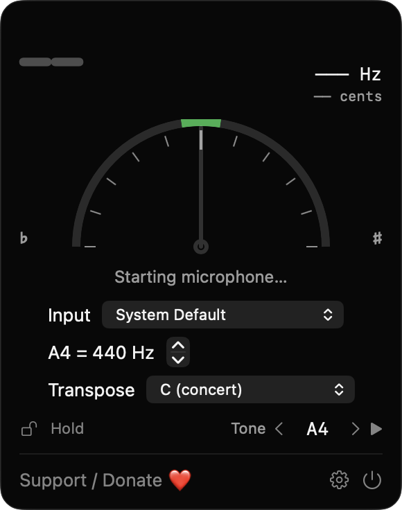
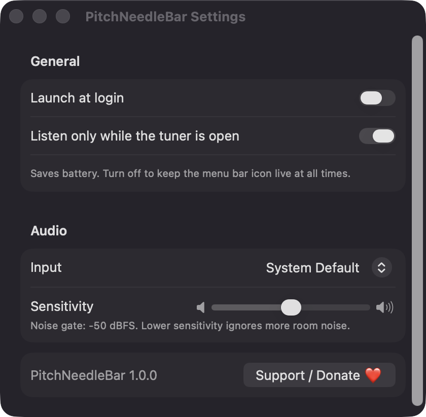

# PitchNeedleBar

**🌐 Website:** [turhe123.github.io/pitch-needle-bar](https://turhe123.github.io/pitch-needle-bar/)

A menu bar chromatic tuner that listens through your mic and shows how sharp or flat each note is.

> 🆓 A free, open-source **ChromTuner alternative** for macOS 14+. Native Swift, no accounts, no subscriptions, MIT licensed.


## Why

PitchNeedleBar is a free, open-source, 100% native, backend-free alternative to paid utilities in the *Audio* category. It was inspired by ChromTuner ($6.99 one-time), a nice example of a quick desktop tuner for guitars, violins and voices. PitchNeedleBar reproduces the core of that idea in one small menu bar window. There is no account, no subscription, no network code and no server: audio is analysed locally and never recorded or sent anywhere.

## Features

- **Real-time pitch detection** from the microphone using the McLeod normalized square difference method, built on Accelerate (vDSP) with parabolic interpolation. Detects roughly 30 Hz to 2 kHz.
- **Note name, octave, frequency (Hz) and cents** shown in a large readout at the top of the popover.
- **Semicircular needle gauge** spanning −50 to +50 cents. The needle and note turn green within ±5 cents.
- **Menu bar tuning-fork icon** that turns green while you are in tune.
- **Steady readings**: an RMS noise gate plus a five-reading median filter. Idle state shows dashes and "Play a note".
- **Adjustable reference pitch** (A4 = 415–466 Hz, default 440), clamped to the valid range with a message.
- **Transposition** for C (concert), B♭ (trumpet, clarinet), E♭ (alto sax), F (horn) and A (clarinet in A).
- **Hold button** to freeze the current reading.
- **Reference tone generator** (sine wave): pick a note with the arrows and play it to tune by ear. The mic is paused while the tone plays through the built-in speakers to avoid feedback; use headphones to tune along.
- **Input device picker** with automatic fallback to the system default and a notice if the selected mic disappears.
- **Settings**: launch at login, input device, noise-gate sensitivity slider, and "listen only while the tuner is open" (on by default to save battery).
- **Blocked view** with a shortcut to Privacy settings if microphone access is denied.
- Lives only in the menu bar (no Dock icon). Native Swift/SwiftUI, universal binary (Apple Silicon and Intel).

## Screenshots

<p align="center"></p>

<p align="center"><em>The menu bar tuner popover with its needle gauge from −50 to +50 cents, input picker, A4 reference pitch, transposition and reference-tone controls.</em></p>

<p align="center"></p>

<p align="center"><em>Settings for launch at login, listening only while the tuner is open, input device and noise-gate sensitivity.</em></p>

## Install

1. Download `PitchNeedleBar-macOS.zip` from the [latest release](https://github.com/turhe123/pitch-needle-bar/releases/latest).
2. Unzip it and move `PitchNeedleBar.app` to `/Applications`.
3. Because the app is open source and not notarized, remove the quarantine attribute:

   ```bash
   xattr -cr /Applications/PitchNeedleBar.app
   ```

4. Right-click the app and choose **Open** the first time you launch it.

## Build from source

Requires macOS 14+ and Xcode with Swift 5.9+.

```bash
brew install xcodegen
xcodegen generate
xcodebuild -project PitchNeedleBar.xcodeproj -scheme PitchNeedleBar -configuration Release -derivedDataPath ./build build
```

The app is produced at `build/Build/Products/Release/PitchNeedleBar.app`.

## Permissions

- **Microphone**: required. PitchNeedleBar listens to your mic to detect the pitch of the note you play. macOS asks the first time you open the tuner. Audio is processed locally and never recorded or sent anywhere.
- **Login item** (optional): only used if you enable "Launch at login" in Settings, via `SMAppService`.

The app does **not** request Accessibility or Screen Recording access, and makes no network connections. The only outbound action is opening the Ko-fi page in your browser when you click the Support button.

## Built with AI

PitchNeedleBar was written by [Claude Code](https://claude.com/claude-code) inside an automated pipeline, from a plain-English spec. No code, binaries or assets from any commercial app were used; it is a clean-room reimplementation of a feature set, not a copy.

What that means in practice:

- The full source is in this repo under the MIT license. Read it before you run it.
- No network calls, no analytics, no third-party dependencies. Only Apple frameworks.
- Ad-hoc signed and not notarized, which is why Gatekeeper warns on first launch.
- It has had less human review than a hand-written app. Bug reports and pull requests are welcome.

## Support ❤️

If PitchNeedleBar is useful to you, you can support its development:

[Support Or (Leo) Davidai ❤️](https://ko-fi.com/leodavidai)

## More free Mac apps

PitchNeedleBar is one of [60 free, open-source Mac utilities](https://github.com/turhe123/mac-apps) built the same way: native Swift, no accounts, no telemetry. Browse the full gallery at [turhe123.github.io/mac-apps](https://turhe123.github.io/mac-apps/).

## License

MIT © Or Davidai Bachar
